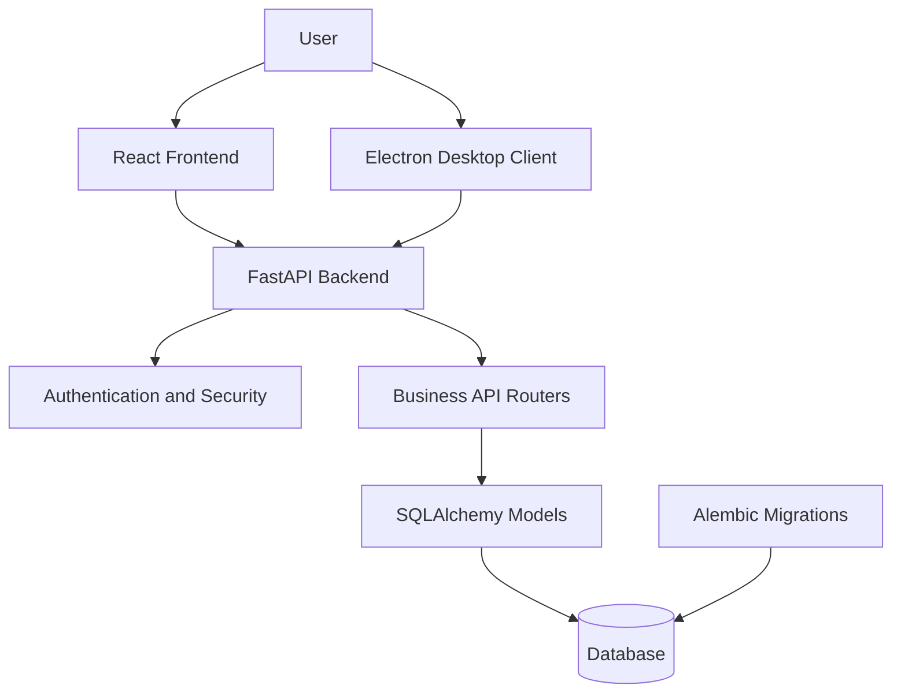

 <div align="center">


# Grocery Mart — Retail POS Management System

### A modern platform for grocery billing, inventory, sales, and retail operations.

<p>
  
  
  
</p>

<p>
  <a href="https://github.com/vikas468368-star/Grocery-Mart">Repository</a> ·
  <a href="https://github.com/vikas468368-star/Grocery-Mart/issues">Report an Issue</a> ·
  <a href="https://github.com/vikas468368-star/Grocery-Mart/pulls">Contribute</a>
</p>

</div>

---

## Overview

**Grocery Mart** is a grocery retail and point-of-sale (POS) management project designed to bring essential store operations into one application.

The project combines a React-based frontend, a Python FastAPI backend, and an Electron desktop client. Its modular structure supports the development of billing, product management, sales processing, supplier operations, and business reporting features.

The goal is to provide a clear, maintainable foundation for a retail management application that can evolve with the needs of grocery stores and supermarkets.

## Key Features

| Module | Description |
|---|---|
| Point of Sale | Interface and API modules for retail billing workflows |
| Product Management | Organize and manage product records |
| Category Management | Group products into categories |
| Customer Management | Maintain customer-related records |
| Supplier Management | Manage supplier information and operations |
| Sales and Orders | Support sales and order management workflows |
| Payments | Dedicated payment API module |
| Reports | Reporting API module for business information |
| Returns | Dedicated module for return workflows |
| User Authentication | Authentication and security components |
| Desktop Application | Electron entry point and preload integration |
| Database Migrations | Alembic configuration and migration scripts |

> Feature availability and completion may vary as development progresses. Refer to the source code and project issues for the current implementation status.

## Technology Stack

<div align="center">

| Layer | Technologies |
|---|---|
| Frontend | React, JavaScript, Vite, CSS |
| Backend | Python, FastAPI |
| API | REST-style API endpoints |
| Database | SQLAlchemy database layer |
| Migrations | Alembic |
| Desktop | Electron, JavaScript |
| Containers | Docker, Docker Compose |

</div>

## Architecture

The application is organized into three main layers.



### Application flow

1. The user interacts with the web interface or desktop client.
2. The frontend communicates with the backend API.
3. FastAPI routes requests to the relevant business module.
4. Database models and configuration support data operations.
5. Alembic manages database schema migrations.

## Project Structure

```text
Grocery-Mart/
├── .gitignore
├── README.md
└── Grocery POS/
    ├── README.md
    ├── package.json
    ├── package-lock.json
    ├── docker-compose.yml
    │
    ├── backend/
    │   ├── .env.example
    │   ├── Dockerfile
    │   ├── alembic.ini
    │   ├── alembic/
    │   └── app/
    │       ├── main.py
    │       ├── core/
    │       ├── models/
    │       ├── routers/
    │       ├── schemas/
    │       └── seeds/
    │
    ├── frontend/
    │   ├── package.json
    │   ├── index.html
    │   └── src/
    │       ├── api/
    │       ├── components/
    │       ├── context/
    │       ├── hooks/
    │       └── pages/
    │
    └── desktop/
        ├── package.json
        ├── main.js
        └── preload.js
```

## Getting Started

### Prerequisites

Install the following software before running the project:

- Git
- Python 3.10 or a compatible version supported by the backend dependencies
- Node.js and npm
- A database configured for the backend
- Docker Desktop, if using the containerized setup

### 1. Clone the repository

```bash
git clone https://github.com/vikas468368-star/Grocery-Mart.git
cd Grocery-Mart
cd "Grocery POS"
```

### 2. Configure the backend

```bash
cd backend
python -m venv .venv
```

Activate the environment on Windows PowerShell:

```powershell
.\.venv\Scripts\Activate.ps1
```

Install dependencies:

```bash
python -m pip install -r requirements.txt
```

Create your local environment configuration using the provided example file:

```powershell
Copy-Item .env.example .env
```

Edit `.env` with your local database connection and required application settings. Never commit real passwords, API keys, or secret values.

Run database migrations using the project's configured database:

```bash
alembic upgrade head
```

Start the API server:

```bash
uvicorn app.main:app --reload
```

The API will typically be available at:

`http://127.0.0.1:8000`

If enabled in the FastAPI application, interactive API documentation is available at:

`http://127.0.0.1:8000/docs`

### 3. Configure the frontend

Open a second terminal:

```powershell
cd "C:\path\to\Grocery-Mart\Grocery POS\frontend"
npm install
npm run dev
```

Replace the example path with the actual location of your cloned repository.

Vite will display the local development URL in the terminal. Open that URL in your browser.

Ensure the frontend API configuration points to the running backend.

### 4. Run the desktop application

After installing the desktop package dependencies:

```powershell
cd "C:\path\to\Grocery-Mart\Grocery POS\desktop"
npm install
```

Check `desktop/package.json` for the available scripts before launching Electron:

```powershell
npm run
```

Use the development or build script provided by that package. The desktop client also requires the appropriate frontend build and backend services or configuration.

### 5. Run with Docker

The project includes a `docker-compose.yml` file. Review its service definitions and environment requirements, then run the configured services from the application directory:

```bash
docker compose up --build
```

Use the ports and service configuration defined in the Compose file.

## Development Workflow

The recommended development workflow is:

1. Start and verify the backend.
2. Confirm the database connection and migrations.
3. Start the frontend and verify API connectivity.
4. Test the relevant business workflow.
5. Test the desktop client when desktop-specific changes are made.
6. Review logs and automated tests before submitting changes.

## Security and Configuration

- Keep secrets in local environment files.
- Do not commit `.env` files containing credentials.
- Validate input on the backend.
- Apply appropriate authentication and authorization to protected endpoints.
- Use database migrations to manage schema changes.
- Avoid committing generated builds, dependency directories, and local database files.

## Roadmap

Potential areas for continued development include:

- Complete end-to-end billing and checkout workflows.
- Strengthen inventory updates and stock validation.
- Improve sales and business reporting.
- Expand automated API and frontend tests.
- Refine desktop packaging and installation.
- Improve deployment documentation and production configuration.

These items are development goals, not claims that the features are already complete.

## Contributing

Contributions, bug reports, and improvement suggestions are welcome.

1. Fork the repository.
2. Create a feature branch.

   ```bash
   git checkout -b feature/your-feature
   ```

3. Make focused changes and test them.
4. Commit your changes.

   ```bash
   git add .
   git commit -m "Add: describe your change"
   ```

5. Push the branch.

   ```bash
   git push origin feature/your-feature
   ```

6. Open a pull request describing the change and its testing status.

## Project Status

**Development status:** Under development and testing.

The repository contains the main frontend, backend, and desktop application structure. Feature completeness, deployment readiness, and production security should be verified before the application is used in a live retail environment.

## License

No license is specified here. Add a `LICENSE` file to the repository before declaring reuse or distribution terms.

---

<div align="center">


**Grocery Mart**

*Building a more organized retail management experience.*

<sub>Developed by Vikas Madheshiya</sub>

</div>
