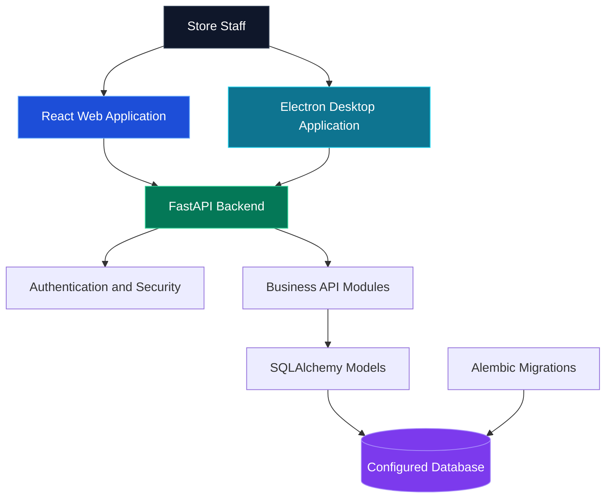

 <div align="center">


<br/>

<a href="https://github.com/vikas468368-star/Grocery-Mart">

</a>
<a href="https://github.com/vikas468368-star/Grocery-Mart/issues">

</a>
<a href="https://github.com/vikas468368-star/Grocery-Mart">

</a>

**A modern grocery retail management system built to organize everyday store operations through a unified web, backend, and desktop architecture.**

[Explore Repository](https://github.com/vikas468368-star/Grocery-Mart) · [Report an Issue](https://github.com/vikas468368-star/Grocery-Mart/issues) · [View Source Code](https://github.com/vikas468368-star/Grocery-Mart/tree/main/Grocery%20POS)

</div>

---

## Overview

**Grocery Mart** is a full-stack Point of Sale (POS) and retail management project designed for grocery stores, retail shops, and supermarkets.

The project brings essential retail workflows into one application, including billing, product management, inventory-related operations, customer records, supplier management, sales, orders, payments, and reporting.

Its modular architecture combines a React frontend, Python FastAPI backend, and Electron desktop client. The codebase is structured to support maintainable development and future expansion.

> **Project status:** Under development and testing. Individual features should be tested before being considered production-ready.

## Key Features

| Module | Purpose |
|---|---|
| Point of Sale | Support retail billing and checkout workflows |
| Product Management | Organize and manage product records |
| Category Management | Group products into meaningful categories |
| Customer Management | Maintain customer-related information |
| Supplier Management | Organize supplier records and operations |
| Sales and Orders | Provide modules for sales and order workflows |
| Payments | Handle payment-related API operations |
| Returns | Provide a dedicated module for return workflows |
| Authentication | Support application authentication and security |
| Business Reports | Provide reporting functionality through dedicated API routes |
| Desktop Application | Offer an Electron-based desktop application structure |
| Database Migrations | Manage database schema changes with Alembic |

Feature availability and completion may vary as development continues.

## Technology Stack

<div align="center">

| Layer | Technologies |
|---|---|
| Frontend | React, JavaScript, Vite, CSS |
| Backend | Python, FastAPI |
| API | REST-style endpoints |
| Database Layer | SQLAlchemy |
| Schema Migrations | Alembic |
| Desktop | Electron, JavaScript |
| Containerization | Docker, Docker Compose |
| Version Control | Git, GitHub |

</div>

## System Architecture



### How it works

1. Store staff interact with the web interface or desktop client.
2. The client communicates with the FastAPI backend.
3. API routers handle requests for the relevant business module.
4. SQLAlchemy provides the database access layer.
5. Alembic manages database schema migrations.

## Project Structure

```text
Grocery-Mart/
├── .gitignore
├── README.md
└── Grocery POS/
    ├── README.md
    ├── package.json
    ├── package-lock.json
    ├── docker-compose.yml
    │
    ├── backend/
    │   ├── .env.example
    │   ├── Dockerfile
    │   ├── requirements.txt
    │   ├── alembic.ini
    │   ├── alembic/
    │   └── app/
    │       ├── main.py
    │       ├── core/
    │       ├── models/
    │       ├── routers/
    │       ├── schemas/
    │       └── seeds/
    │
    ├── frontend/
    │   ├── package.json
    │   ├── index.html
    │   └── src/
    │       ├── api/
    │       ├── assets/
    │       ├── components/
    │       ├── context/
    │       ├── hooks/
    │       └── pages/
    │
    └── desktop/
        ├── package.json
        ├── main.js
        ├── preload.js
        └── assets/
```

## Getting Started

Follow these steps to set up the project on your local machine.

### Prerequisites

Install the following tools:

- Git
- Python compatible with the backend dependencies
- Node.js and npm
- A database supported by the project's configuration
- Docker Desktop, if you want to use Docker

### 1. Clone the repository

```bash
git clone https://github.com/vikas468368-star/Grocery-Mart.git
cd Grocery-Mart
cd "Grocery POS"
```

### 2. Set up the backend

Open a terminal inside the `Grocery POS` directory.

Create a Python virtual environment:

```powershell
cd backend
python -m venv .venv
```

Activate it on Windows PowerShell:

```powershell
.\.venv\Scripts\Activate.ps1
```

Install the backend dependencies:

```powershell
python -m pip install -r requirements.txt
```

Create your local environment configuration:

```powershell
Copy-Item .env.example .env
```

Edit `.env` and configure the required database connection and application settings. Do not commit real passwords, tokens, or secret keys.

Run the database migrations:

```powershell
alembic upgrade head
```

Start the backend server:

```powershell
uvicorn app.main:app --reload
```

When the server starts successfully, the API is typically available at:

- API base URL: `http://127.0.0.1:8000`
- Interactive API documentation: `http://127.0.0.1:8000/docs`

These URLs assume the default Uvicorn configuration and that the application starts successfully.

### 3. Set up the frontend

Open a second terminal:

```powershell
cd "Grocery POS\frontend"
npm install
npm run dev
```

Open the local URL printed by Vite in your terminal.

Make sure the frontend API configuration points to the running backend.

### 4. Set up the desktop application

Open another terminal:

```powershell
cd "Grocery POS\desktop"
npm install
npm run
```

The final command lists the scripts defined in the desktop package. Use the appropriate script listed there to start or build the Electron application.

The desktop application may require the frontend build and backend services to be configured and running.

### 5. Run with Docker

Docker Compose configuration is included in the project.

From the `Grocery POS` directory, inspect the Compose file and its environment requirements, then run:

```powershell
docker compose up --build
```

The available services, ports, and environment variables depend on the Compose configuration.

## Development Workflow

For a reliable development process:

1. Start the backend and verify that it initializes correctly.
2. Confirm the database configuration and migrations.
3. Start the frontend and verify its connection to the API.
4. Test the business workflows relevant to your changes.
5. Test the Electron client when modifying desktop-specific functionality.
6. Review errors and run available tests before committing changes.

## Security and Configuration

Security should be considered throughout development.

- Keep credentials and secret keys in local environment variables.
- Never commit real `.env` files containing secrets.
- Validate incoming data on the backend.
- Apply appropriate authentication and authorization to protected operations.
- Keep database migrations under version control.
- Exclude dependency folders, generated builds, and local database files from Git.
- Test the application's security and data handling before production deployment.

## Roadmap

The following are potential development priorities, not claims that every feature is already complete.

- [ ] Verify end-to-end billing and checkout workflows.
- [ ] Strengthen inventory updates and stock validation.
- [ ] Improve sales reports and business analytics.
- [ ] Expand automated backend and frontend tests.
- [ ] Refine desktop packaging and installation.
- [ ] Improve deployment documentation and production configuration.
- [ ] Validate authentication, authorization, and error handling.
- [ ] Perform end-to-end testing across the web and desktop clients.

## Contributing

Contributions, bug reports, and improvement suggestions are welcome.

1. Fork the repository.
2. Create a feature branch:

   ```bash
   git checkout -b feature/your-feature
   ```

3. Make your changes and test them.
4. Commit your changes:

   ```bash
   git add .
   git commit -m "Add: describe your change"
   ```

5. Push your branch:

   ```bash
   git push origin feature/your-feature
   ```

6. Open a pull request explaining the changes and the tests performed.

## Project Status

**Current stage:** Under development and testing.

The repository contains the main frontend, backend, and desktop application structure. Feature completeness, production security, and deployment readiness still need to be verified before use in a live retail environment.

## License

A license has not yet been specified in this repository. Add an appropriate `LICENSE` file before defining reuse and distribution permissions.

---

<div align="center">


**Grocery Mart**

Building a more organized retail management experience.

Developed by **Vikas Madheshiya**

[GitHub Repository](https://github.com/vikas468368-star/Grocery-Mart)

</div>
